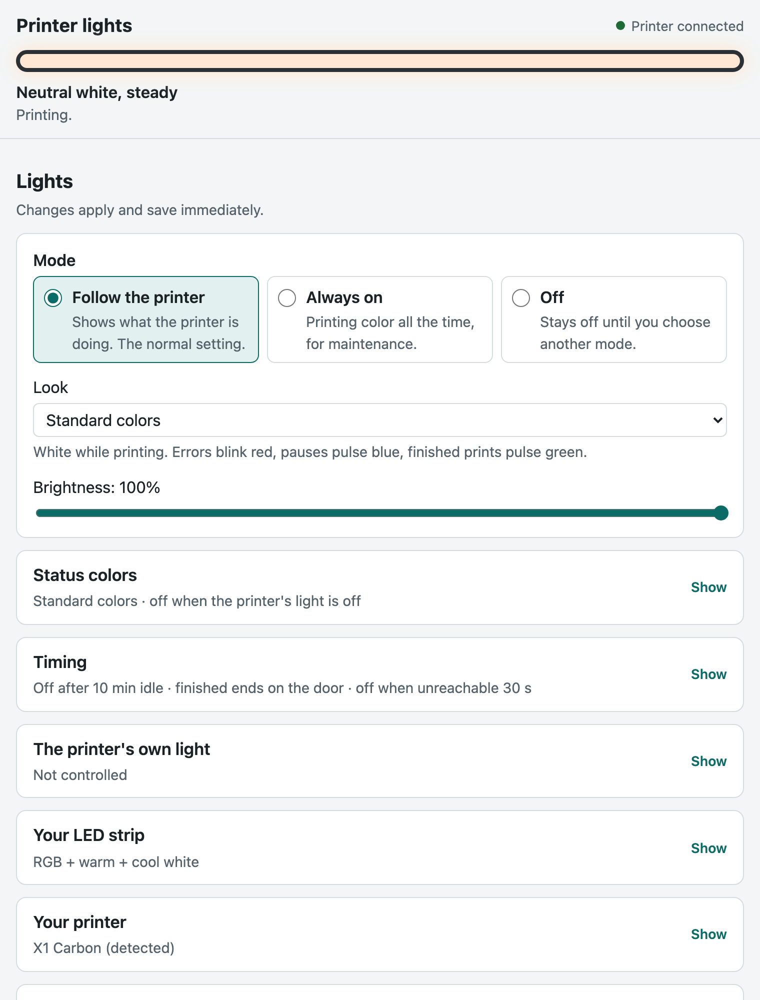
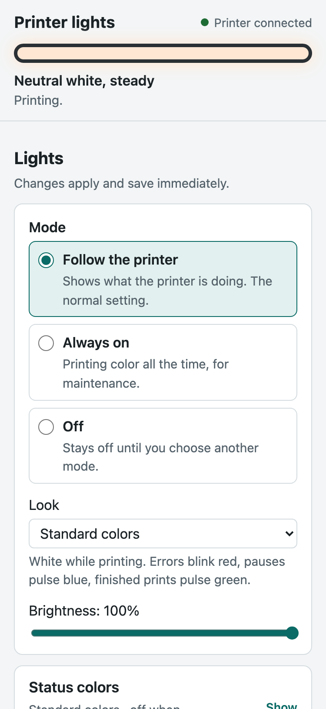
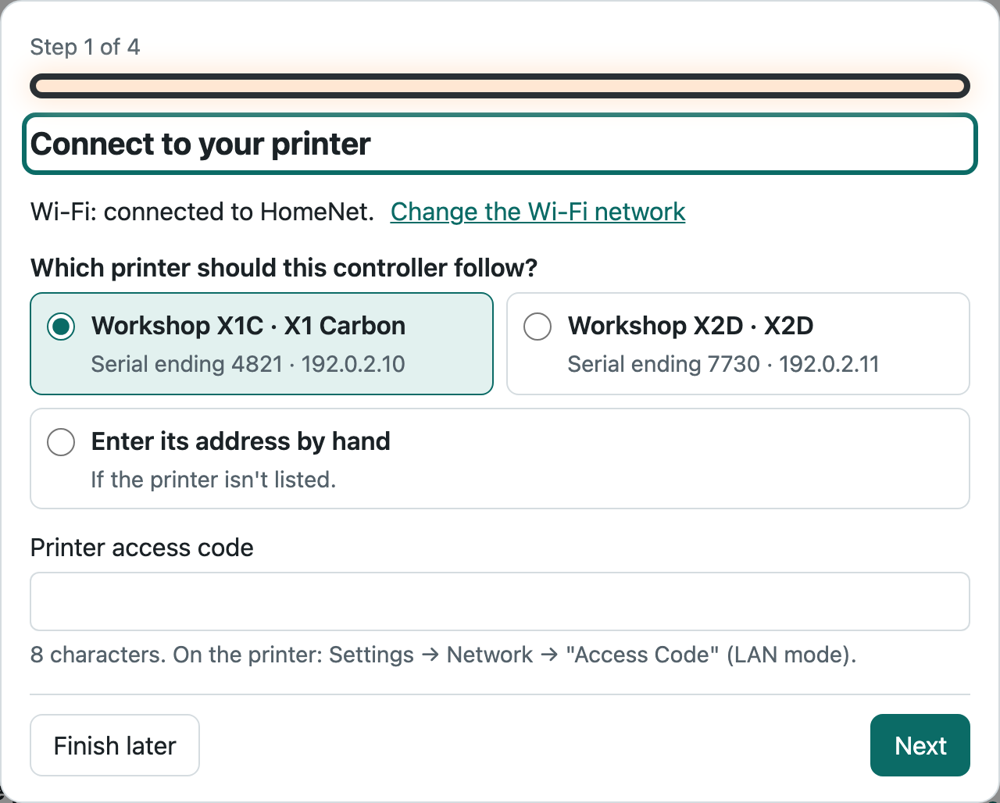
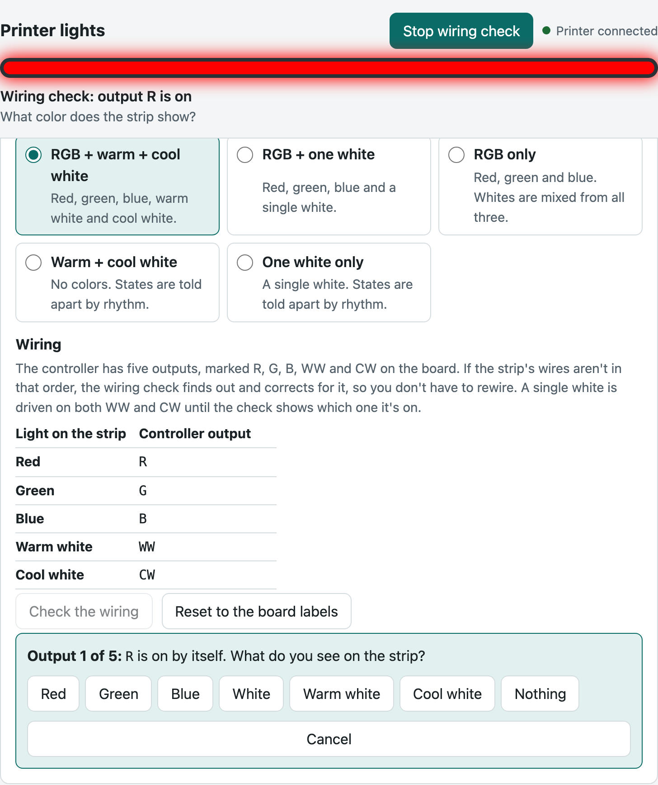
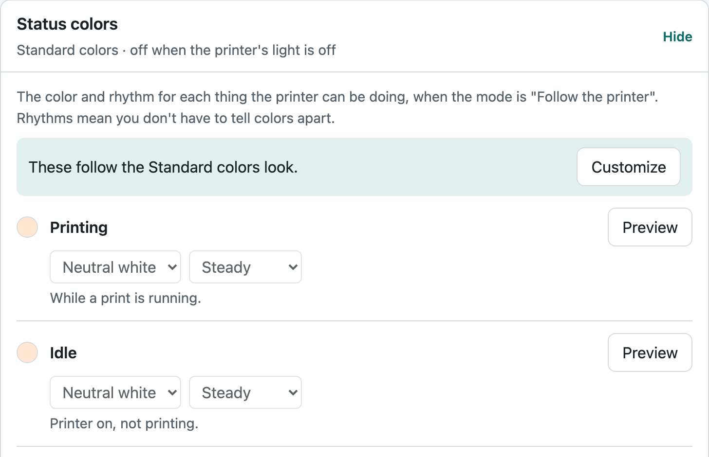
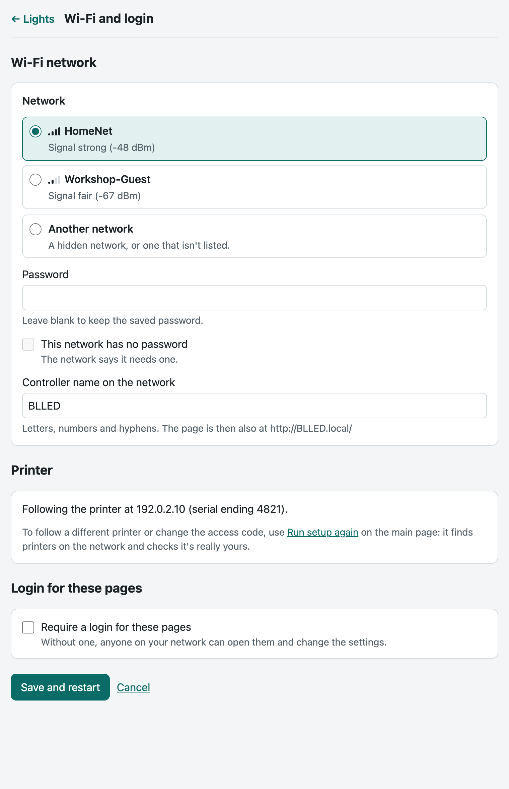

<h1>
  <picture>
    <source media="(prefers-color-scheme: dark)" srcset="docs/logo-dark.png">
    
  </picture>
</h1>

**Alternative firmware for [BLLED controllers](https://www.dutchdevelop.com/blled)**: the ESP32 LED controller for Bambu Lab
printers. It lights your printer's chamber when that's useful and turns it off when it isn't,
with no switch to flip, and shows at a glance when a print needs you. It runs on the same
hardware as [BLLEDController](https://github.com/DutchDevelop/BLLEDController) by DutchDevelop,
which it's built on.

Current version: **1.0.0**. Tested on a Bambu Lab X1 Carbon with an RGB + white strip.

## What it does

- **Light that follows the printer.** On while it prints, off a while after it goes idle,
  woken by the door; it can also switch the printer's own chamber light (each of those is a
  separate setting). By default the strip stays lit while the nozzle is cleaned and the bed
  leveled, so the X1 camera sets its exposure for a lit chamber, and goes dark for the lidar
  steps.
- **Status you can read from across the room.** Errors blink red, a pause or a first-layer
  problem pulses blue, a finished print pulses green until you open the door (or after a set
  time). Rhythms mean you don't have to tell colors apart.
- **It says why.** The setup page's status line always explains what the strip shows ("Off: no
  activity for 15 min. Open the door or start a print to wake it."). Nothing hidden: no secret
  door gestures.
- **One setup page, autosaved.** Mode, look (standard colors, white only, or your own) and
  brightness up front; everything else folded away. A four-step setup on first use. Works on a
  phone, in light and dark mode, with a keyboard or a screen reader.
- **Your strip, wired your way.** RGB + warm + cool white, RGB + one white, RGB only, warm +
  cool white, or one white, and a wiring check that finds swapped wires and corrects for them.
- **Knows your printer.** Finds Bambu printers on the network, reads their model and name, and
  looks up a printer's serial from its address.
- **Safer.** The printer's access code is only sent to a printer that proves it's yours (its
  certificate is issued to its serial and signed by Bambu Lab). With a login set, every page
  needs it; secrets are never sent back to the browser; other websites can't change settings
  from your browser.
- **Smart-home ready.** A JSON API and a companion [Hubitat driver](#hubitat).
- **Steady.** No freezes, recovers by itself after a power cut, gentle reconnects, and 129
  automated tests of the real code.

The full design and every decision behind it: [docs/REDESIGN.md](docs/REDESIGN.md). What changed
in each version: [CHANGELOG.md](CHANGELOG.md).

## Screenshots

Taken from the test mock (`tools/mock_device.py`), so the printers and network are made up.

**The setup page during a print**, with the status line on top (it follows your light or dark
mode), and the same page on a phone:

  <picture>
    <source media="(prefers-color-scheme: dark)" srcset="docs/screenshots/setup-printing-dark.webp">
    
  </picture>
  

**First-run setup**, four steps. Step 1 lists the printers found on the network:

**Your LED strip**: pick the strip type, then the wiring check lights each output in turn and
asks what you see:

**Status colors**: a color and a rhythm for each printer state, with a live preview:

**Wi-Fi and login**: the network list with signal strength, the controller's name, and an
optional login:

## What you need

- A **BLLED controller** and an LED strip. DutchDevelop sells the controller (an ESP32 board
  with a five-channel LED driver): see the [BLLED controller page](https://www.dutchdevelop.com/blled).
  ReBLLED runs on the same hardware as their
  [BLLEDController](https://github.com/DutchDevelop/BLLEDController) firmware.
- A **Bambu Lab printer** on your network, and its **access code** (on the printer: Settings →
  Network). Tested on the X1 Carbon. Other models are recognized (X1, X1E, P1P, P1S, P2S, A1,
  A1 mini, A2L, H2D, H2D Pro, H2S, H2C, X2D) but not yet tested; the setup page says so.
- **Bambu firmware note:** newer Bambu firmware restricts third-party local access
  ("Authorization Control"). If the controller can't connect after a printer update, LAN
  Developer Mode may be needed, as for BLLED itself.

## Install

**From BLLED (DutchDevelop's firmware):**

1. On the controller's setup page, **download a backup** of your configuration (Backup &
   Restore).
2. Open its **firmware update** page and upload `ReBLLED_V1.0.0.bin.ota` from the
   [release](https://github.com/brossow/ReBLLED/releases).
3. It restarts into ReBLLED. Your Wi-Fi, printer and login carry over, and your LED settings
   are converted (the original file is kept on the controller); a setting your BLLED version
   didn't have gets ReBLLED's default. Then, under **Your LED strip**,
   pick your strip type and run the wiring check.

**On a new controller:** flash DutchDevelop's firmware with the
[BLLED web flasher](https://dutchdevelop.github.io/Universal-Flasher/), join its `BLLED_AP` Wi-Fi
hotspot to connect it to your network, then install ReBLLED as above. (Or write the full image
`ReBLLED_V1.0.0.bin` over USB; that erases the controller, see
[docs/USB-MIGRATION.md](docs/USB-MIGRATION.md).)

**Going back:** upload a BLLED `.bin.ota` from
[DutchDevelop's releases](https://github.com/DutchDevelop/BLLEDController/releases) on ReBLLED's
firmware update page, then restore the backup you downloaded. The restore matters: BLLED can't
read ReBLLED's LED settings and would start with a dark strip.

The controller keeps the names it had (the `BLLED_AP` setup hotspot, `BLLED.local`), so
existing setups and bookmarks keep working.

## Hubitat

A companion [Hubitat driver](https://github.com/brossow/hubitat-drivers/tree/main/reblled)
shows the controller's live status on your hub (what the strip shows and why, printing,
paused, finished, door, errors) and switches the strip and sets its brightness, for rules
like "strip on with the shop lights" or "announce when a print finishes". It installs
through Hubitat Package Manager or by importing the driver code.

ReBLLED's JSON API (`/api/status`, `/api/settings`, the status push on `/ws`) is described
in [docs/REDESIGN.md](docs/REDESIGN.md) for anyone connecting another system.

## Questions and feedback

Questions, setups and results on other printer models: the
[ReBLLED thread on the Bambu Lab forum](https://forum.bambulab.com/t/reblled-alternative-firmware-for-blled-chamber-light-controllers-x1c-tested/261265).
Bugs: [GitHub issues](https://github.com/brossow/ReBLLED/issues). For the Hubitat driver, its
[Hubitat community thread](https://community.hubitat.com/t/release-reblled-led-controller-status-and-control-for-blled-chamber-lights-on-bambu-lab-printers/166906).

## Working on ReBLLED

| Task | Command |
|---|---|
| Build | `pio run -e esp32dev` → `.firmware/ReBLLED_V<version>.bin.ota` (over the air) and `.firmware/ReBLLED_V<version>.bin` (full 4 MB image, USB) |
| Run the tests | `pio test -e native`; the printer certificate check: `brew install mbedtls`, then `pio test -e native_tls` |
| Update a device over the air | `tools/flash.sh <device-ip>` (reads the WebUI login from the macOS Keychain; see the script header) |
| Try the setup pages without hardware | `python3 tools/mock_device.py src/www 8765`, then http://localhost:8765 (Wi-Fi setup) or http://localhost:8765/setup. `POST /_sim` changes what the simulated printer is doing (see the script header) |
| Check a device for main-loop freezes | `python3 tools/ws_timing.py <device-ip> 60` |
| Log the printer's stages with times (for example, to line up a print start with the camera) | `python3 tools/stage_log.py <device-ip> [minutes]` |
| Switch a device to the larger partition layout | [docs/USB-MIGRATION.md](docs/USB-MIGRATION.md) |

[TESTING.md](TESTING.md) is the on-device checklist (with results); [TODO.md](TODO.md) lists what's next.

## Credits and license

ReBLLED is by [brossow](https://github.com/brossow), built on
[BLLEDController](https://github.com/DutchDevelop/BLLEDController) 2.3.0 by
[DutchDeveloper](https://dutchdevelop.com/), with credit to its contributors:
[Modbot](https://github.com/Modbot) (testing), [xps3riments](https://github.com/xps3riments)
(the original foundation), [longrackslabs](https://github.com/longrackslabs) (build, docs,
community) and [SoftWareCrash](https://github.com/softwarecrash). ReBLLED is an independent
project: it isn't made or endorsed by DutchDevelop or by Bambu Lab, and "Bambu Lab" is their
trademark.

Same license as BLLEDController: see [LICENSE](LICENSE) (based on CC BY-NC-SA 4.0:
non-commercial, share-alike, credit the original). ReBLLED changes the original substantially;
[CHANGELOG.md](CHANGELOG.md) lists how.
